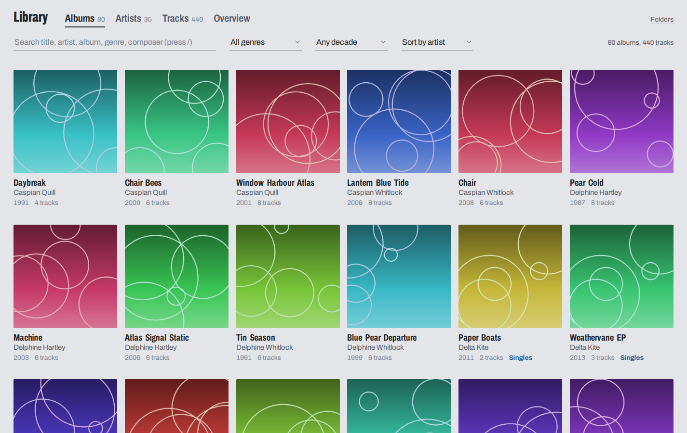
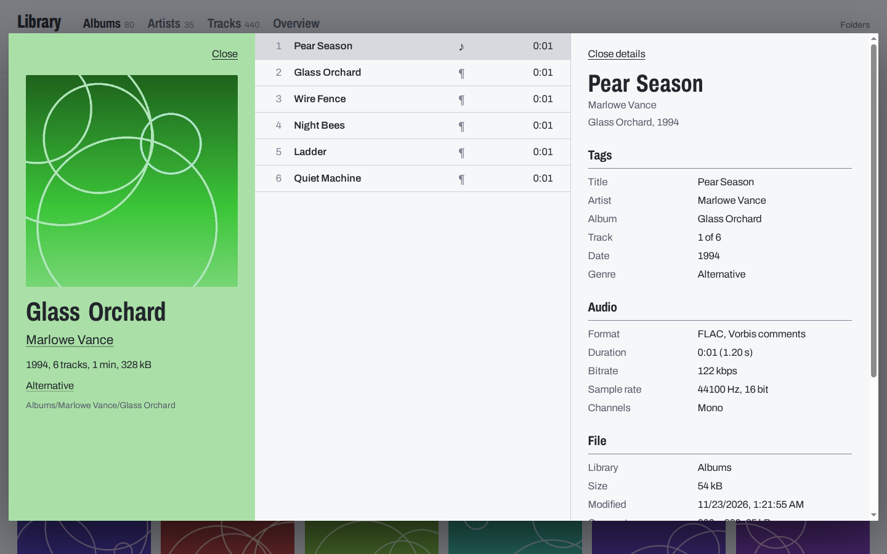
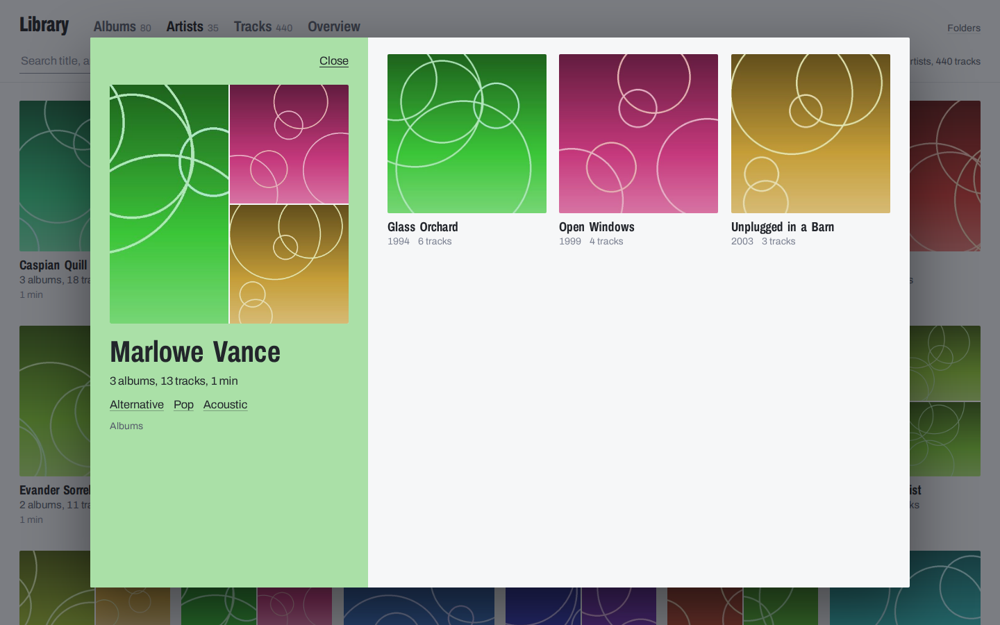
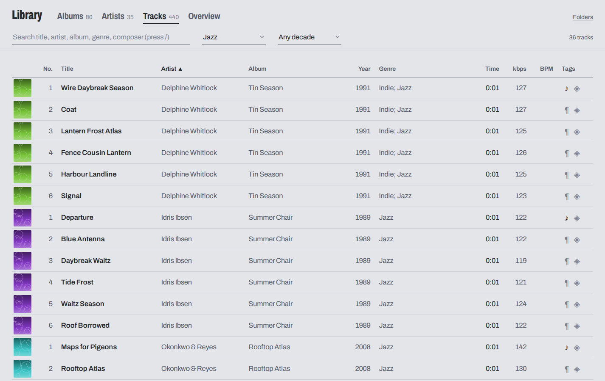
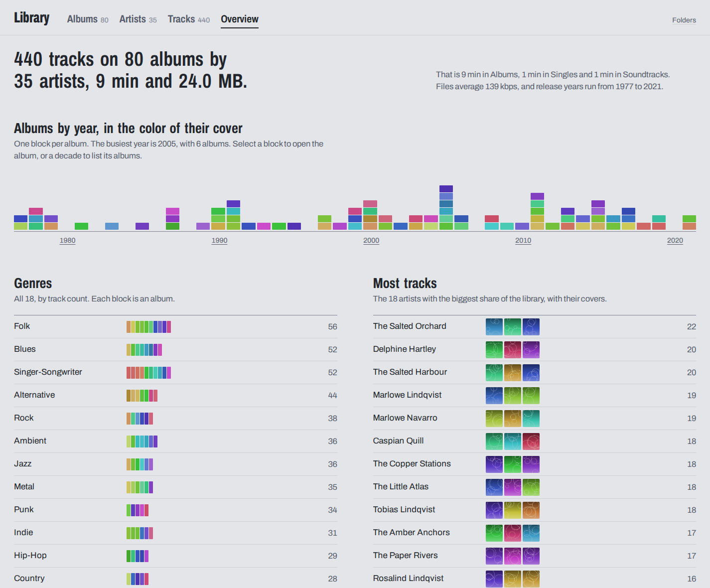
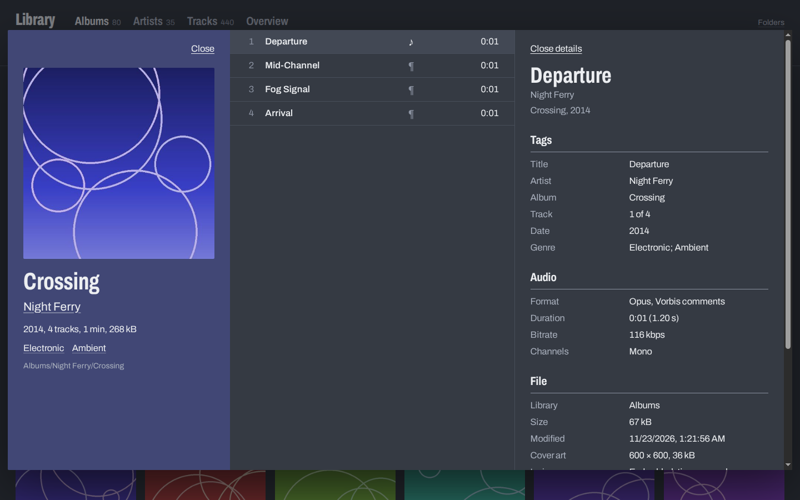
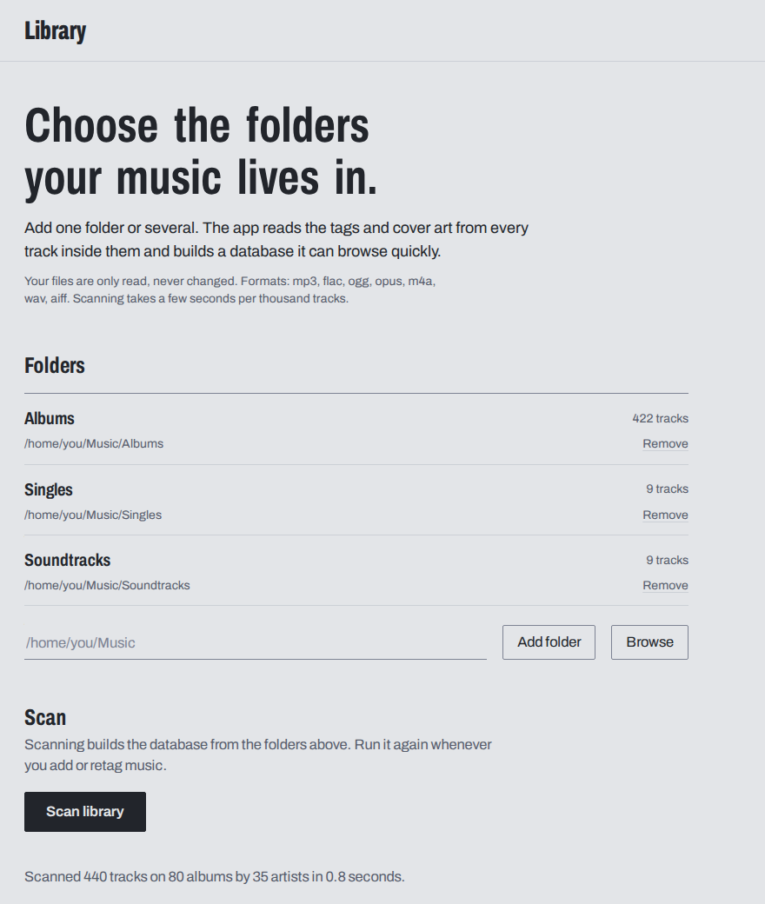

# Music Library

A local web app for browsing your music collection by what the tags say: albums as a wall of covers,
artists, a sortable track table, and an overview of genres, years and missing tags. Point it at one or
more folders. It reads every track's tags and cover art into a small database once, then browses from
that database, so it stays fast and never touches your files again.

It does not play audio. Use whatever player you already have; this is for seeing and checking your metadata.

## What you get

Screenshots show the demo library from `tools/make_demo_library.py` (invented artists, one-second tones), not real music.

**Albums, as a wall of covers.** Search across title, artist, album, genre, composer and publisher; filter by genre
or decade; sort by artist, title, year, track count, length or recently changed. Albums from a second or third folder carry that folder's name.

**An album, and any track in it.** Select an album to open its sheet, tinted with the cover's dominant colour, with
the tracklist beside it. Select a track for everything the file knows: every tag, codec, bitrate, sample rate and bit
depth, size, cover resolution, ReplayGain, lyrics (with or without timestamps) and where the cover came from.

**Artists.** An artist with several albums opens to a sheet of all of them; an artist with one album opens that album directly.

**Tracks, as a table.** Sortable columns, the same filters, and marks for lyrics and MusicBrainz ids.

**Overview.** Every album as a block in the colour of its cover, stacked by release year; the largest genres and artists;
and a list of gaps in your tags (no track number, no lyrics, no cover, possible duplicates...) where each row opens the
tracks that are missing it.

**Light and dark**, following your system setting.

**Choosing folders.** Type a path or browse, name each folder, scan, with live progress.

## Run it

Needs Python 3.9 or newer (developed on 3.14).

    pip install -r requirements.txt
    python3 server.py ~/Music

Open http://localhost:8766. The first run scans the folder (about 15 seconds per thousand tracks);
the page shows progress. Next time `python3 server.py` alone serves the same folders, and
`python3 server.py --rescan` reads them again after you add or retag music.

Several folders, each shown as its own library:

    python3 server.py ~/Music Soundtracks=/mnt/disk/ost

Or start with no arguments and choose folders in the browser (**Folders** in the top bar): type a path or
browse, name each folder, then press **Scan library**.

Try it without your own music: `python3 tools/make_demo_library.py demo-music` makes an invented library
of about 80 albums (needs ffmpeg), then `python3 server.py demo-music/Albums demo-music/Singles demo-music/Soundtracks`.

| Option | |
| --- | --- |
| `--port 8766`, `--host 127.0.0.1` | where to listen |
| `--data ./data` | where the database and the saved folder list go (or set `MUSIC_LIBRARY_DATA`) |
| `--rescan` | scan again even if the folders are unchanged |
| `--remote-setup` | with a non-local `--host`, still allow choosing folders in the browser |

`python3 scan.py ~/Music` scans without starting the server.

## What it reads

mp3 (ID3v2), flac, ogg and opus (Vorbis comments), m4a/mp4 (MP4 atoms), wav and aiff. Per track: title,
artist, album, album artist, track and disc numbers, date, original date, genre, composer, BPM, key,
copyright, publisher, lyrics (and whether they carry timestamps), ReplayGain, MusicBrainz ids, codec, bitrate,
sample rate, bit depth, and the cover art, either embedded or a `cover`/`folder`/`front` image beside the
tracks. A `.lrc` file next to a track counts as its lyrics.

**How tracks become albums and artists.** An album is a folder (`CD1`/`Disc 2` subfolders count as part
of their parent). If most of a folder is laid out `Artist/Album/tracks`, the artist is the folder name.
Otherwise the artist comes from the tags: album artist, else track artist, else "Various Artists" when
they differ. A flat folder that mixes many albums is split by its album tags. Files with no tags show
their file name and land under "Unknown artist".

## Your data stays yours

Everything the app learns about your music lives in the data folder (`./data` by default, ignored by
git): `music.db` and `config.json` with your folder paths. Nothing is sent anywhere. Your music folders are
opened read-only.

The server listens on `127.0.0.1` only. It checks the `Host` and `Origin` headers, so other websites you
have open cannot drive it. If you bind it to another address, the in-browser folder picker and scan button
are switched off unless you pass `--remote-setup`; do that only on a network you trust, because it lets
anyone who can reach the page list folders on this machine.

## The database

`music.db` has two layers, both rebuilt on every scan.

* **Extracted** (`scan.py`, `tags.py`): `sources` (the folders), `tracks` (every tag as a column, audio info,
  lyrics, ReplayGain, MusicBrainz ids), `tags_raw` (every tag as written in the file), `covers`
  (de-duplicated JPEG thumbnails).
* **Built for the browser** (`derive.py`): `artists`, `albums`, `genres`, `years`, `flags` (gaps in the tags),
  `stats`, each with ready-made id lists, plus a dominant colour for every cover.

The page only reads these tables; it does not recompute albums or statistics from raw track rows.
After editing `tracks` by hand, `python3 derive.py --db data/music.db` rebuilds the second layer alone.

## Keep it running

On Linux with systemd, a user service that starts at login (add `loginctl enable-linger $USER` to start at boot):

    # ~/.config/systemd/user/music-library.service
    [Unit]
    Description=Music Library

    [Service]
    WorkingDirectory=/path/to/music-library
    ExecStart=/usr/bin/python3 -u server.py
    Restart=always
    RestartSec=5

    [Install]
    WantedBy=default.target

then `systemctl --user enable --now music-library`.

## Layout

    server.py   web server, API, scan control          web/index.html   the library UI
    scan.py     folders -> database                    web/setup.html   folder picker and scan page
    tags.py     one reader per tag format              web/fonts/       Archivo (SIL OFL, see OFL.txt)
    derive.py   database -> browsing tables            tools/           demo library generator
    config.py   saved folders and data location

The type is Archivo (variable weight and width), a narrow heavy cut for titles and normal width for the rest.
Each album's dominant cover colour tints its sheet and drives the colour-by-year chart on the Overview.
